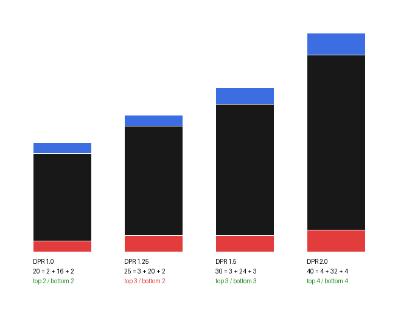
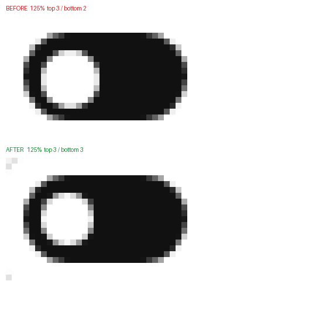

# 125% 缩放下开关滑块偏移 1px

## 结论

小尺寸开关在 Windows 125% 缩放下，滑块在轨道里上下不等距。根因只有一条：**上下留白合计 4px，乘以 1.25 等于 5 个设备像素，5 是奇数，分不平。**

改 CSS 写法治不好，改固定尺寸也只能救特定的缩放档。唯一有效的做法是：**尺寸不写死，按 DPR 把每段长度量化成整物理像素，滑块大小由轨道高度反推。** 改完七档缩放上下留白全部相等。

## 现象

- 滑块在轨道里偏上或偏下 1 个设备像素，125% 下等于 0.8 个 CSS 像素。
- 偏哪边不固定，取决于元素在页面上的垂直相位；换一行位置，可能从偏上变成偏下。
- 同一套代码在 100% / 150% / 200% 下完全正常。
- 水平方向滑块贴着轨道一端，是「开」状态的设计，不是错位，不在讨论范围。

## 原理

浏览器里长度分两层：

- **CSS 像素**：写 `2px` 的那个 px
- **设备像素**：屏幕真实的物理点

```
设备像素 = CSS 像素 × 缩放比例
```

125% 时，轨道 12px 变成 15 个设备像素，滑块 8px 变成 10 个，上下各留 2px 变成各 2.5 个。

浏览器光栅化时把边吸附到设备像素网格，2.5 只能落到 3 或 2。上下各 2.5，最终必然一边 3 一边 2。



红 = 上边留白，黑 = 滑块，蓝 = 下边留白。只有 125% 那根红蓝不等长。

## 规律

> **上下（或左右）两边留白的合计，乘以缩放比例后如果是奇数个设备像素，就必然分不平，一边多 1 个设备像素。**

| 留白合计 | × 1.25 | 奇偶 | 结果 |
| --- | --- | --- | --- |
| 4px（2 + 2） | 5 | 奇 | 偏 1px |
| 8px（4 + 4） | 10 | 偶 | 正常 |

同一个设置面板里的分段控件用 4px 内边距，125% 下实测上下各 5、左右各 5，纹丝不动。这条规律不是猜的。

## 改前实测

两个真实案例，几何关系完全一致。

**案例 A：DSH 插件 `dsh-slash-space` 的开关**

```css
.track { width:22px; height:12px; border-radius:999px }
.knob  { top:2px; left:2px; width:8px; height:8px; border-radius:50% }
```

**案例 B：DSH 本体设计系统的 `Switch` 组件**

```css
._switch_1ik0f_5 { width:36px; height:20px; padding:2px; border-radius:999px }
._thumb_1ik0f_33 { width:16px; height:16px; border-radius:50% }
```

四档缩放各渲染一次，量上下留白：

| 缩放 | A 轨道 / 滑块（设备像素） | A 上 / 下 | B 轨道 / 滑块（设备像素） | B 上 / 下 |
| --- | --- | --- | --- | --- |
| 100% | 22×12 / 8×8 | 2 / 2 ✓ | 36×20 / 16×16 | 2 / 2 ✓ |
| **125%** | **28×15 / 10×10** | **3 / 2 ✗** | **45×25 / 20×20** | **3 / 2 ✗** |
| 150% | 33×18 / 12×12 | 3 / 3 ✓ | 54×30 / 24×24 | 3 / 3 ✓ |
| 200% | 44×24 / 16×16 | 4 / 4 ✓ | 72×40 / 32×32 | 4 / 4 ✓ |

两个案例在 125% 下都差 1 个设备像素，方向都是偏上。

## 为什么常见写法都治不好

| 尝试 | 125% 下上 / 下 | 结论 |
| --- | --- | --- |
| `top:2px`（原写法） | 3 / 2 | 差 1 |
| `top:50%` + `translateY(-50%)` | 3 / 2 | 差 1 |
| `top:0; bottom:0; margin:auto` | 3 / 2 | 差 1 |
| 去掉 `transform` 的独立合成层 | 3 / 2 | 差 1 |
| 把滑块改成 7.2px、内边距 2.4px | 3 / 3 | 125% 好了，110% 和 130% 又偏 |

前四种是「怎么算居中」，但 2.5 就是 2.5，换成哪种写法都要取整。

第五种是「把数字凑成 0.8 的整数倍」。它只能救特定的缩放档：7.2px 在 1.25 下是 9 个设备像素，在 1.1 下是 7.92 个，照样非整数。

> **结论：任何写死的尺寸，都只对某些缩放比例成立。** 想全档通过，只能在运行时按当前 DPR 算。

## 解法

### 思路

把三个长度都变成「整物理像素」：

```
pad    = round(2  × dpr)   内边距
trackW = round(22 × dpr)   轨道宽
trackH = round(12 × dpr)   轨道高
knob   = trackH - pad × 2  滑块（从轨道高反推）
travel = trackW - pad × 2 - knob
```

关键在 `knob` 不是独立设定的，而是**从轨道高反推**出来的。这样 `pad + knob + pad = trackH` 在几何上恒成立，取整永远不会落到一边。同理 `travel` 保证开状态左右留白都等于 `pad`。

最后再把设备像素数除以 dpr 换回 CSS 像素写进样式：

```js
const px = (value) => Number((value / dpr).toFixed(4)) + 'px'
```

### 代码

CSS 里尺寸全部走变量，带原来的值做兜底：

```css
.dsh-slash-space-track{width:var(--dsh-slash-space-track-w,22px);height:var(--dsh-slash-space-track-h,12px)}
.dsh-slash-space-knob{top:var(--dsh-slash-space-pad,2px);left:var(--dsh-slash-space-pad,2px);width:var(--dsh-slash-space-knob,8px);height:var(--dsh-slash-space-knob,8px)}
.dsh-slash-space.is-on .dsh-slash-space-knob{transform:translateX(var(--dsh-slash-space-travel,10px))}
```

JS 在挂载时算一次，并监听缩放变化：

```js
const METRIC_VARS = [
  '--dsh-slash-space-track-w',
  '--dsh-slash-space-track-h',
  '--dsh-slash-space-pad',
  '--dsh-slash-space-knob',
  '--dsh-slash-space-travel',
]

function installMetrics() {
  const view = typeof window === 'undefined' ? null : window
  if (view === null) return () => {}
  const root = document.documentElement
  const previous = METRIC_VARS.map((name) => [
    name,
    root.style.getPropertyValue(name),
    root.style.getPropertyPriority(name),
  ])
  let media = null
  const apply = () => {
    const dpr = view.devicePixelRatio || 1
    const pad = Math.max(1, Math.round(2 * dpr))
    const trackW = Math.max(pad * 2 + 1, Math.round(22 * dpr))
    const trackH = Math.max(pad * 2 + 1, Math.round(12 * dpr))
    const knob = trackH - pad * 2
    const travel = trackW - pad * 2 - knob
    const px = (value) => Number((value / dpr).toFixed(4)) + 'px'
    root.style.setProperty(METRIC_VARS[0], px(trackW))
    root.style.setProperty(METRIC_VARS[1], px(trackH))
    root.style.setProperty(METRIC_VARS[2], px(pad))
    root.style.setProperty(METRIC_VARS[3], px(knob))
    root.style.setProperty(METRIC_VARS[4], px(travel))
    if (media !== null) media.removeEventListener('change', apply)
    media = typeof view.matchMedia === 'function'
      ? view.matchMedia('(resolution: ' + dpr + 'dppx)')
      : null
    if (media !== null) media.addEventListener('change', apply)
  }
  apply()
  return () => {
    if (media !== null) media.removeEventListener('change', apply)
    for (const [name, value, priority] of previous) {
      if (value === '') root.style.removeProperty(name)
      else root.style.setProperty(name, value, priority)
    }
  }
}
```

监听用 `(resolution: Ndppx)`，缩放一变媒体查询翻转，`apply` 重算，再挂到新的 dpr 上。卸载时把变量恢复原样。

## 改后实测

七档缩放的垂直留白全部相等；五档标准缩放的「开」状态左右留白也准确：

| 缩放 | 轨道 | 滑块 | 上 / 下 | 开状态左 / 右 |
| --- | --- | --- | --- | --- |
| 100% | 22×12 | 8×8 | 2 / 2 ✓ | 12 / 2 ✓ |
| 110% | 24×13 | 8×9 | 2 / 2 ✓ | — |
| **125%** | **28×15** | **9×9** | **3 / 3 ✓** | **16 / 3 ✓** |
| 130% | 29×16 | 9×10 | 3 / 3 ✓ | — |
| 150% | 33×18 | 12×12 | 3 / 3 ✓ | 18 / 3 ✓ |
| **175%** | **39×21** | **13×13** | **4 / 4 ✓** | **22 / 4 ✓** |
| 200% | 44×24 | 16×16 | 4 / 4 ✓ | 24 / 4 ✓ |

125% 和 175% 原来分别偏 3/2 和 4/3，现在都是相等的。



## 边界

- **非标准缩放（110% / 130%）**：垂直仍然精确居中，但水平方向因为按钮自身的内边距不是整物理像素，滑块左右边缘会有 1px 抗锯齿，量出来是 8×9、9×10 而不是正方。标准五档没有这个问题。
- **JS 没跑起来时**：CSS 兜底值就是原来的 22/12/2/8/10，会退化成改之前的样子，不会坏。
- **变量作用域**：变量挂在 `documentElement` 上，全局生效；类名有命名空间，不会和别的组件撞。

## 为什么「到处都是」

不是每个页面各写错一处：

- **同一个组件**：`Switch` 被 6 个包引用（通用设置、模型设置、会话日志、子代理、联网搜索、插件管理），共 7 处，一处尺寸六处露馅。
- **照抄**：插件作者照着设计系统 2px 内边距写，抄得没错，问题在源头。

本体那 7 处截至本文仍未修，本文记录的是插件侧的做法，可以直接搬过去。

## 自查清单

看到「差一点点」「不居中」，按这个顺序查：

- [ ] 量实际留白：截图后逐像素量，不靠肉眼
- [ ] 算：留白合计 × 缩放比例，是奇数个设备像素吗
- [ ] 换 100% / 150% / 200% 各看一眼：整数倍正常、分数倍异常，就是取整
- [ ] 125% 和 175% 是重灾区（1.25、1.75 都会产生奇数）
- [ ] 检查是不是写死了尺寸：写死就只能对一档缩放
- [ ] 固定高度容器里 flex 居中：容器高与子元素高之差，换算成设备像素是偶数吗
- [ ] 1px 边框在 125% 下发虚发灰，是同一套算术的另一种表现（1.25 个设备像素无法锐利），症状不同、根因同源

## 怎么量

1. 用系统截图工具截目标元素，确保截图本身没有被缩放
2. 逐像素统计：深色区域 = 轨道外框，内部亮色区域 = 滑块
3. 算上下（左右）留白的像素差

本次结论用的就是这套方法，另外用 Edge headless 在七档 `--force-device-scale-factor` 下渲染同一段 CSS 做对照。

## 证据出处

- 插件：`client.js`（`.dsh-slash-space-track` / `.dsh-slash-space-knob` / `installMetrics`）
- 本体：`@deepseek-ai/dsh-client-ui-theme` 里的 `Switch` 组件样式
- 系统缩放：125%（设备像素比 1.25）
- 验证方式：Edge headless + `--force-device-scale-factor`，逐像素量取
